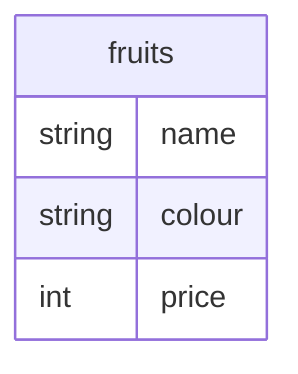

To be able to use Rego for data filtering, the policy needs to be constructed to

1. correctly represent the desired row filtering logic
2. properly be **translatable into the target representation** (such as SQL)

The subset of Rego that can be used to represent row filtering logic is colloquially referred to as the **fragment**.

:::info What you will learn
You will develop an intuition for what is valid Rego for data filters depending on the target.
Not every construct is supported for every target.

For a step-by-step walkthrough of evaluating a Rego policy _partially_, see [Evaluating a data filter policy](./partial-evaluation).
:::

## What is Partial Evaluation?

The translation of data policies into queries (like SQL WHERE clauses) is driven by _partial evaluation (PE)_ of a Rego query.

> With partial evaluation, callers specify that certain inputs or pieces of data are _unknown_. OPA evaluates as much of the policy as possible without touching parts that depend on unknown values.<sup>[1](/blog/partial-evaluation-162750eaf422)</sup>

The _unknown_ values that remain during partial evaluation represent the pieces of data that represent your filter.

:::tip
When only _known_ values are used, **you can use all of Rego.**
:::

## Example Preamble

In this running example, assume a table `fruits` exists with columns `name`, `colour`, and `price`.



## Context data for Partial Evaluation

### Unknowns: database rows

Database rows are **unknown** at policy evaluation time — OPA does not have access to the database. They are represented in Rego using the convention `input.<TABLE>.<COLUMN>`, e.g. `input.fruits.name` refers to the `name` column of the `fruits` table.

The **METADATA annotation** on the policy package declares which `input` paths are unknown. OPA uses this to know which parts of the policy to leave as conditions rather than evaluate:

```rego title="policy.rego"
# METADATA
# scope: package
# compile:
#   unknowns: [input.fruits]
package filters

include if input.fruits.name == "banana"
```

With `input.fruits` declared as unknown, OPA will not try to resolve `input.fruits.name` during partial evaluation — instead it becomes a column reference in the output SQL.

### Known values: request context

Our data filters also depend on user information. These **known values** are sent to OPA as input at query time and will be substituted during partial evaluation:

```json
{
  "name": "april",
  "email": "april@corp.com",
  "fav_colour": "yellow",
  "budget": 10
}
```

They are referenced in the policy as `input.user`, e.g. `input.user.budget`. Because they are not listed in `unknowns`, OPA resolves them to their concrete values during partial evaluation.

## Simple comparisons

The fragment supports simple comparisons, such as `==`, `!=`, `<`, `>`, `<=`, `>=`, between _unknown_ and _known_ values.
It is not important if the _unknown_ is on the left-hand side ("LHS") or right-hand side ("RHS"), but it is critical that only one side is _unknown_:

:::tip OK

```rego
package filters

include if {
    input.fruits.name == "banana"                # LHS unknown, RHS constant
    input.fruits.price <= input.user.budget      # LHS unknown, RHS known.
    input.user.fav_colour == input.fruits.colour # LHS known, RHS unknown.
}
```

SQL target: `WHERE name = 'banana' AND price <= 10 AND colour = 'yellow'`

As you can see the _known_ values from `input.user` have been replaced.
:::

:::danger NOT OK

```rego
package filters

include if {
    input.fruits.name != input.fruits.colour # LHS and RHS unknown
    input.fruits.price                       # plain unknown
}
```

:::

:::info SQL
For SQL translation targets, it's possible to have unknowns on both sides of the simple comparisons.

```rego
package filters

include if input.fruits.name != input.fruits.colour
```

SQL target: `WHERE name <> colour`
:::

:::info "Is Anything"
For SQL and UCAST/Prisma, it's valid to assert that a field exists by unifying it with a wildcard:

```rego
package filters

include if input.fruits.price = _
```

SQL target: `WHERE name IS NOT NULL`

A more common way to do this would be function definition shorthands, like

```rego
package filters

include if {
    some pat in data.filter.patterns
    matches(pat, input.fruit.name)
}

matches("*", _) # "*" matches everything
matches(x, x)   # exact match
```

Here, the first `matches` definition would yield an expression like `_ = input.fruit.name` in the partial evaluation results.
:::

## Built-in Functions

Certain built-in functions can be translated with certain restrictions:

- `startswith`
- `endswith`
- `contains`
- `k in ...` (not `k, v in ...`)

These built-in functions can only be used with _unknowns_ on the left-hand side.

:::tip OK

```rego
package filters

include if {
    startswith(input.fruits.name, "ba")
    input.fruits.colour in {"blue", "green"}
}
```

SQL target: `WHERE name LIKE 'ba%' AND colour IN ('blue', 'green')`.
:::

:::danger NOT OK

```rego
package filters

include if {
    endswith("apple", input.fruits.name)        # RHS unknown
    1, input.fruits.colour in ["blue", "green"] # k, v in ...
    regexp.match(input.fruits.name, '^b[an]+$') # unsupported builtin (for unknown values)
}
```

:::

Other built-in functions are not supported **for usage with _unknown_ values**.
If your filtering rules use other built-ins with _known values_, that's OK -- see below for an example.

## Rules and functions

Many Rego constructs are available for building filters, with certain restrictions:

1. `every` may not be used with _unknown_ values, unless it ranges over a known collection (see [`every`](../policy-reference/keywords/every#partial-evaluation))
2. `default` rules (or functions) may not be used in combination with _unknown_ values

Nonetheless, you can use rules and functions to structure your policy, as long as these restrictions are observed:

:::tip OK

```rego
package filters

include if user_in_corp

include if {
    not user_in_corp
    apple_ish
}

# apple_ish rule does not use `default` or `every`
apple_ish if input.fruits.name == "pineapple"
apple_ish if input.fruits.name == "apple"

# user_in_corp only uses known values
default user_in_corp := false
user_in_corp if endswith(lower(input.user.email), "@corp.com")
```

SQL target: `WHERE name = 'pineapple'` if the user's email is not ending in `@corp.com`. If it does, the filter would be empty, not restricting the database query.
:::

:::danger NOT OK

```rego
package filters

include if only_pineapples

default only_pineapples := false                    # default rule
only_pineapples if input.fruits.name == "pineapple"
```

:::

## `not` expressions

Expressions using `not` are permitted for [simple expressions](#simple-comparisons) and [built-in functions](#built-in-functions).
`not` combined with a _unknown_ value or a rule reference is not allowed.
:::tip OK

```rego
package filters

include if {
    not input.fruits.name == "apple"
    not input.fruits.colour in {"blue", "green"}
}
```

SQL target: `WHERE (NOT name = 'apple' AND NOT colour IN ('blue', 'green'))`.
:::

:::danger NOT OK

```rego
package filters

include if not input.fruits.name                    # plain unknown

include if not apple_ish                            # not + rule
apple_ish if endswith(input.fruits.name, "apple")
apple_ish if startswith(input.fruits.name, "apple")
```

:::

## Lucene target

The Lucene target (`Accept: application/vnd.opa.lucene.solr+json`) renders the filter as a query for Solr's [standard query parser](https://solr.apache.org/guide/solr/latest/query-guide/standard-query-parser.html), to be used as `fq` or `q`.

```rego
# METADATA
# scope: package
# compile:
#   unknowns: [input.doc]
package filters

include if {
    input.doc.owner == input.user
    input.doc.level >= 3
    not input.doc.status == "draft"
}
```

For the input `{"user": "alice"}`, the response is

```json
{
  "result": {
    "query": "(owner:\"alice\" AND level:[3 TO *] AND NOT status:\"draft\")"
  }
}
```

- The one unknown is the document, and its fields are the references below it: `input.doc.owner` is the field `owner`, `input.doc.address.city` the field `address.city`.
  More than one document is an error, as a query searches one index. `import input.doc` lets the policy write `doc.owner`.
- A reference without the document, like `input.owner`, has to be declared a field of it: add it to the unknowns, and map it with `{"lucene": {"owner": {"$table": "doc"}}}`.
- `targetSQLTableMappings` (per-target key `lucene`) renames fields: `{"doc": {"owner": "owner_id"}}`, or `{"doc": {"address.city": "town"}}`.
- An unconditional "yes" is `*:*`; for an unconditional "no", the response has no `result`.
- Whether a field is [single-valued or multi-valued](#single-valued-and-multi-valued-fields) can be declared with a schema.
- The target is tested against Solr; other engines with Lucene syntax may differ in details.

### Translation

Each body of a rule, or each rule of the same name, becomes a conjunction, and they are joined by `OR`:

| Rego                                                           | Lucene target                   |
| -------------------------------------------------------------- | ------------------------------- |
| `input.doc.name == "a"` and `input.doc.level > 1` in one body  | `(name:"a" AND level:{1 TO *})` |
| `input.doc.name == "a"` and `input.doc.level > 1` as two rules | `(name:"a" OR level:{1 TO *})`  |
| a single condition                                             | `name:"a"`, without parentheses |

A purely negative conjunction is anchored with the match-all `*:*`, and negative conditions come after the positive ones:

| Rego                                                            | Lucene target                               |
| --------------------------------------------------------------- | ------------------------------------------- |
| `not input.doc.status == "x"`                                   | `(*:* AND NOT status:"x")`                  |
| `input.doc.name == "a"`, then `not input.doc.status == "x"`     | `(name:"a" AND NOT status:"x")`             |
| `not input.doc.status == "x"`, then `not input.doc.name == "a"` | `(*:* AND NOT status:"x" AND NOT name:"a")` |

**Conditions.** The field is on the left, whichever side the unknown is on: `3 <= input.doc.level` is `level:[3 TO *]`.

| Rego                                                     | Lucene target                           |
| -------------------------------------------------------- | --------------------------------------- |
| `input.doc.name == "x"`                                  | `name:"x"`                              |
| `input.doc.level == 3`                                   | `level:3`                               |
| `input.doc.active == true`                               | `active:true`                           |
| `input.doc.name != "x"`                                  | `(name:[* TO *] AND NOT name:"x")`      |
| `input.doc.level < 3`                                    | `level:{* TO 3}`                        |
| `input.doc.level <= 3`                                   | `level:[* TO 3]`                        |
| `input.doc.level > 3`                                    | `level:{3 TO *}`                        |
| `input.doc.level >= 3`                                   | `level:[3 TO *]`                        |
| `input.doc.created >= "2024-01-01T00:00:00Z"`            | `created:["2024-01-01T00:00:00Z" TO *]` |
| `input.doc.name in {"a", "b"}`                           | `name:("a" OR "b")`                     |
| `input.doc.name != null`, `input.doc.name = _`           | `name:[* TO *]`                         |
| `not input.doc.name != null`                             | `(*:* AND NOT name:[* TO *])`           |
| `not input.doc.name == "x"`                              | `(*:* AND NOT name:"x")`                |
| `not input.doc.name in {"a", "b"}`                       | `(*:* AND NOT name:("a" OR "b"))`       |
| `startswith(input.doc.name, "ap")`                       | `name:ap*`                              |
| `endswith(input.doc.name, "le")`                         | `name:*le`                              |
| `contains(input.doc.name, "pl")`                         | `name:*pl*`                             |
| `strings.any_prefix_match(input.doc.name, ["ap", "ch"])` | `name:(ap* OR ch*)`                     |
| `strings.any_suffix_match(input.doc.name, ["le", "ry"])` | `name:(*le OR *ry)`                     |

- `{` and `}` exclude a bound, `[` and `]` include it. Only numbers and strings can be bounds.
- As in Rego, `input.doc.name != "x"` does not hold for a document without `name`, and `not input.doc.name == "x"` does.
- Solr leaves a field without a value out of the document, so `input.doc.name == null` is rejected: it never holds. `!= null` means "has a value", and `not input.doc.name != null` "has none".
- Strings are quoted, with `\` and `"` escaped, so a `*`, `:` or `OR` in a value from the input is literal.
  A wildcard pattern can't be quoted, so in the pattern of `startswith` and the like, every character but letters and digits gets a `\`: `startswith(input.doc.name, "a b")` is `name:a\ b*`.
  On a `string` field, patterns match case-sensitively, as in Rego. A leading wildcard, as in `endswith` and `contains`, is slow on a large index.
- A field name may contain letters, digits, `_`, `-` and `.`, and starts with a letter or `_`; anything else is an error.

**What can't be translated** is rejected with an HTTP 400 and a `pe_fragment_error`: comparisons between two unknowns, other built-ins on unknowns, `with`, rules left unresolved by partial evaluation, and the [multi-valued forms](#single-valued-and-multi-valued-fields) listed there.
So is a bare reference, as in `include if input.doc.active`; write `input.doc.active != false`, which is what it means in Rego, or `input.doc.active == true`.

### Differences from Rego

Solr matches values according to the field's type in its schema, which OPA does not see. The filter agrees with the policy only if the schema does:

- **Use unanalyzed fields**, like `string`, numeric or date fields. On an analyzed text field, `name:"apple"` also matches `"Big Apple"`.
- **Use values of the field's type.** In Rego, `1 == "1"` is false; in Solr, `price:1` on a `string` field matches `"1"`, and `active:true` matches `"true"`.
- **Ranges** follow the field's type: numeric for numbers, lexicographic for strings and dates. Rego orders a number and a string by type.
- **Missing fields.** A `not` holds for a document without the field, as in Rego with the improved `not` (`import future.keywords.not`, or `rego.v2`), which the Compile API does not accept yet. With the default semantics, Rego fails some of these, like `not input.doc.level < 2`.
- **Objects** have no Lucene counterpart; flatten them into fields.

### Single-valued and multi-valued fields

A Solr field is single-valued, returned as a value (`"owner": "alice"`), or `multiValued`, returned as an array (`"tags": ["a", "b"]`).
The policy compares a single-valued field as it is, `input.doc.owner == "alice"`, and a multi-valued one by its elements, `"a" in input.doc.tags`.
Lucene matches both alike: `tags:"a"` means "some value is `a`".

Declare which a field is with [`schemas` annotations](../policy-language#metadata-schemas) in scope of the compiled rule:

```rego
# METADATA
# scope: package
# compile:
#   unknowns: [input.doc]
# schemas:
#   - input.doc.owner: {"type": "string"}
#   - input.doc.tags: {"type": "array", "items": {"type": "string"}}
#   - input.doc.address.city: {"type": "string"}
package filters
```

A field of type `array` is multi-valued, one of a scalar type single-valued. A schema for the whole document, `input.doc` or `input`, works too, with nested fields as `object` properties.
Using a field the other way is an error, like `"alice" in input.doc.owner` or `input.doc.tags == "a"`; the type checker catches some of these when the policy is loaded, and in `opa test`.
Only inline schemas are used.
Without a schema, a field has the shape the policy uses it with, and using one both ways is an error. Test the policy with documents shaped as Solr returns them.

[`solr_schema.rego`](/filtering/solr_schema.rego) converts the response of Solr's Schema API into these annotations, for `input.doc`:

```shell
curl -s http://localhost:8983/solr/<core>/schema > solr.json
opa eval -f raw -d solr_schema.rego -i solr.json data.solr.annotation
```

A `multiValued` field, or one of a `multiValued` type, becomes an array, and a name with dots, like `origin.country`, is the reference `input.doc.origin.country`. Dynamic fields, and types without a JSON counterpart, are left out.

**Multi-valued fields** can be compared like this:

| Rego                                                                                                                           | Lucene target                                                                     |
| ------------------------------------------------------------------------------------------------------------------------------ | --------------------------------------------------------------------------------- |
| `"a" in input.doc.tags`                                                                                                        | `tags:"a"`                                                                        |
| `some t in input.doc.tags; t == "a"`, `input.doc.tags[_] == "a"`                                                               | `tags:"a"`                                                                        |
| `some t in input.doc.tags; t in {"a", "b"}`                                                                                    | `tags:("a" OR "b")`                                                               |
| `some l in input.doc.levels; l >= 3`                                                                                           | `levels:[3 TO *]`                                                                 |
| `input.doc.tags == []`, `count(input.doc.tags) == 0`                                                                           | `(*:* AND NOT tags:[* TO *])`                                                     |
| `input.doc.tags != []`                                                                                                         | `tags:[* TO *]`                                                                   |
| `every t in input.doc.tags { t != "a" }`                                                                                       | `(*:* AND NOT tags:"a")`                                                          |
| `every t in input.doc.tags { not t in {"a", "b"} }`                                                                            | `(*:* AND NOT tags:("a" OR "b"))`                                                 |
| `some t in input.doc.tags; startswith(t, "a")`                                                                                 | `tags:a*`                                                                         |
| `strings.any_prefix_match(input.doc.tags, ["a", "b"])`, or `some t in input.doc.tags; strings.any_prefix_match(t, ["a", "b"])` | `tags:(a* OR b*)`                                                                 |
| `every t in input.doc.tags { not startswith(t, "a") }`                                                                         | `(*:* AND NOT tags:a*)`                                                           |
| `every l in input.doc.levels { not l < 3 }`                                                                                    | `(*:* AND NOT levels:{* TO 3})`                                                   |
| `every t in input.doc.tags { t == "a" }`                                                                                       | `(*:* AND NOT tags:({* TO "a"} OR {"a" TO *}))`                                   |
| `every t in input.doc.tags { t in {"a", "b"} }`                                                                                | `(*:* AND NOT tags:({* TO "a"} OR {"a" TO "b"} OR {"b" TO *}))`                   |
| `{t \| some t in input.doc.tags} == {"a", "b"}`                                                                                | `(tags:"a" AND tags:"b" AND NOT tags:({* TO "a"} OR {"a" TO "b"} OR {"b" TO *}))` |
| `every g in input.groups { not g in input.doc.tags }`, for the known `input.groups`                                            | `(*:* AND NOT tags:"g1" AND NOT tags:"g2")`                                       |

- "All values are" and "the values are exactly" exclude the ranges around the given values, so they need values that are all strings, or all numbers, on a field that orders them as Rego does.
- `{t | some t in input.doc.tags} == {"a", "b"}` also holds for `["b", "a", "a"]`. `input.doc.tags == {"a", "b"}` never holds: an array is not a set.
- Solr does not index an empty array, so to Solr, `"tags": []` is no `tags` at all. In Rego, `input.doc.tags == []`, `count(input.doc.tags) == 0` and `every` hold for the empty array, but not for a missing field; the filter selects both.

These are rejected, as Lucene can't say them:

- Comparing the whole array, as `input.doc.tags == "a"`, `input.doc.tags == ["a", "b"]`, `input.doc.tags in {"a"}`, or a bare `input.doc.tags`, which is always true.
- "Some value differs", `some t in input.doc.tags; t != "a"`, and "all values are above", `every t in input.doc.tags { t > "a" }` or `{ startswith(t, "a") }`.
- Two conditions on one element, `some l in input.doc.levels; l > 1; l < 3`, as each could be met by a different value. Two elements, `some l ...; l > 1` and `some m ...; m < 3`, are fine.
- A count other than zero, `count(input.doc.tags) == 2`.
- Elements tied by an index, like `tags[i]` and `roles[i]`.
- An `every` over a field with more than one comparison of the element in its body.
- Comparing an element with `null`: a Lucene field has no null value.
